# Lab6Web — Praktikum 6: JavaScript DOM dan Event Handling

| | |
|---|---|
| **Mata Kuliah** | Pemrograman Web |
| **Pertemuan** | 7 |
| **Dosen Pengampu** | Agung Nugroho, S.Kom., M.Kom. |
| **Nama** | Gina Mutmainah |
| **NIM** | 312510490 |
| **Kelas** | I252A |
| **Program Studi** | Teknik Informatika, Fakultas Teknik, Universitas Pelita Bangsa |

## Tujuan Praktikum

1. Memahami DOM sebagai representasi dokumen HTML yang dapat diakses melalui JavaScript.
2. Menggunakan `id`, `class`, dan selector CSS untuk memilih elemen HTML.
3. Mengubah teks, atribut, kelas CSS, dan gaya elemen melalui JavaScript.
4. Menangani event pengguna menggunakan `addEventListener()`.
5. Membuat validasi form dan menampilkan pesan sesuai kondisi input.
6. Mengembangkan halaman interaktif dengan minimal tiga fungsi yang berjalan benar.

## Struktur File

```
Lab6Web/
├── index.html            # Halaman Latihan 1–6
├── style.css             # Gaya Latihan 1–6
├── script.js             # Logika JavaScript Latihan 1–6
├── mini_project/
│   ├── index.html        # Form Pendaftaran Workshop
│   ├── style.css
│   └── script.js
├── screenshots/          # Bukti hasil (tangkapan layar)
└── README.md
```

## Cara Menjalankan

1. Clone atau unduh repository ini.
2. Buka `index.html` di browser modern (Chrome, Edge, atau Firefox) untuk **Latihan 1–6**.
3. Buka `mini_project/index.html` untuk **Mini Project**.
4. Tekan **F12** dan buka tab **Console** untuk memastikan tidak ada error.

Tidak diperlukan instalasi tambahan karena hanya memakai HTML, CSS, dan JavaScript murni. Skrip dimuat dengan atribut `defer` sehingga dijalankan setelah HTML selesai diparsing.

## Langkah Kerja dan Hasil

### Latihan 1 — Mengubah Teks dengan DOM
`getElementById()` memilih elemen judul dan pesan, lalu `textContent` mengganti isinya.

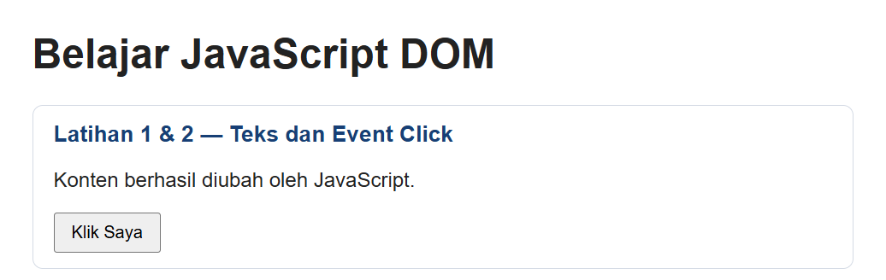

### Latihan 2 — Event Click
`addEventListener("click", ...)` memperbarui paragraf dengan waktu saat tombol ditekan (`new Date().toLocaleTimeString()`).

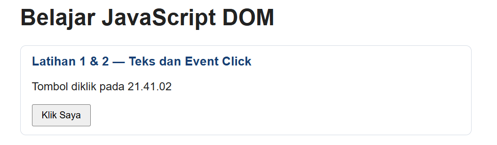

### Latihan 3 — Mengubah Kelas dan Gaya CSS
`classList.toggle()` menambah atau menghapus kelas `highlight` dan `teks-besar` setiap tombol diklik.

| Sebelum klik | Sesudah klik |
|---|---|
| 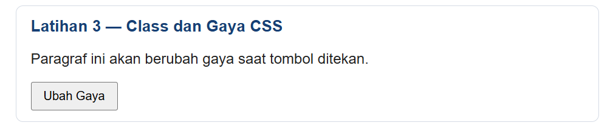 | 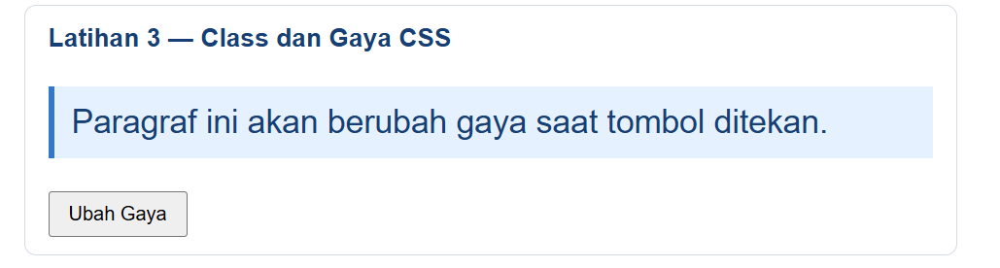 |

### Latihan 4 — Event Input dan Penghitung Karakter
Event `input` memperbarui jumlah karakter secara langsung saat pengguna mengetik, menghapus, atau menempel teks.

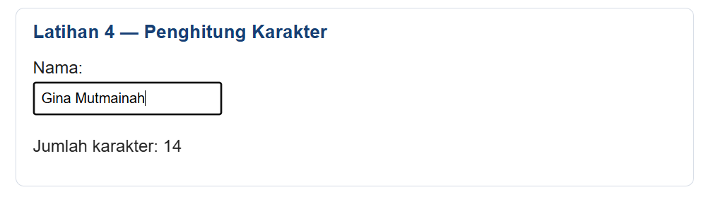

### Latihan 5 — Validasi Form Pendaftaran
`event.preventDefault()` mencegah reload, lalu nama, email (regex), dan usia (bilangan bulat 17–100) diperiksa berurutan.

| No | Kondisi uji | Hasil yang diharapkan | Screenshot |
|---|---|---|---|
| 1 | Semua kosong | Nama wajib diisi. | 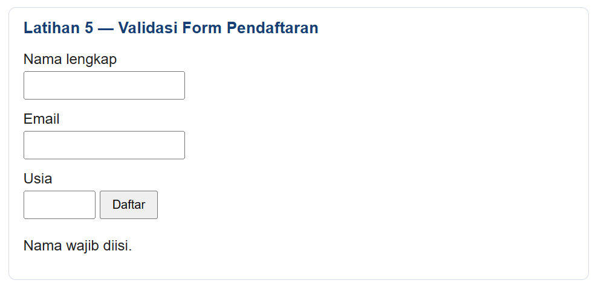 |
| 2 | Nama kosong, data lain valid | Nama wajib diisi. | 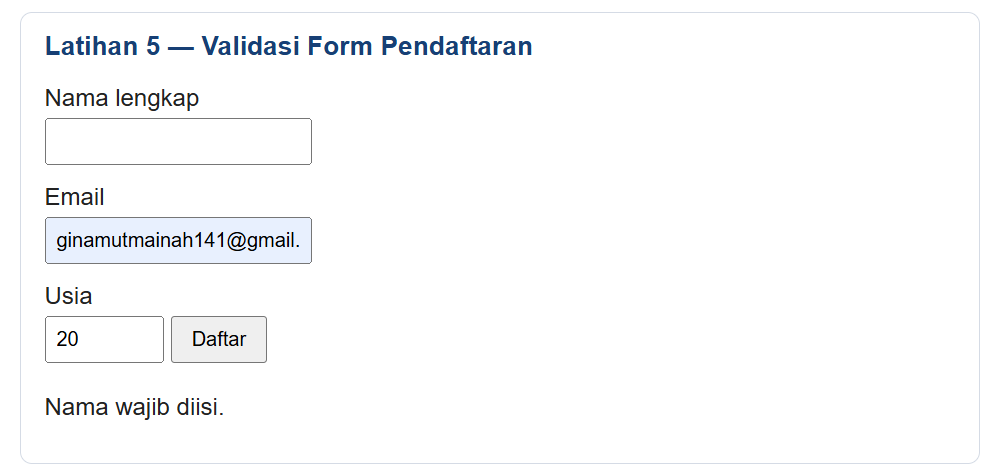 |
| 3 | Email tidak valid | Masukkan email yang valid. | 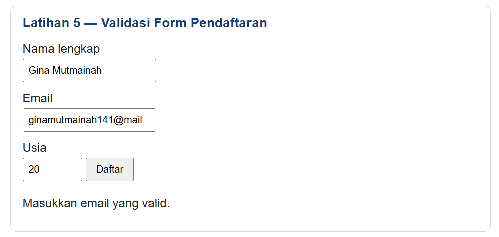 |
| 4 | Usia di bawah 17 (16) | Usia harus berupa bilangan bulat 17–100. | 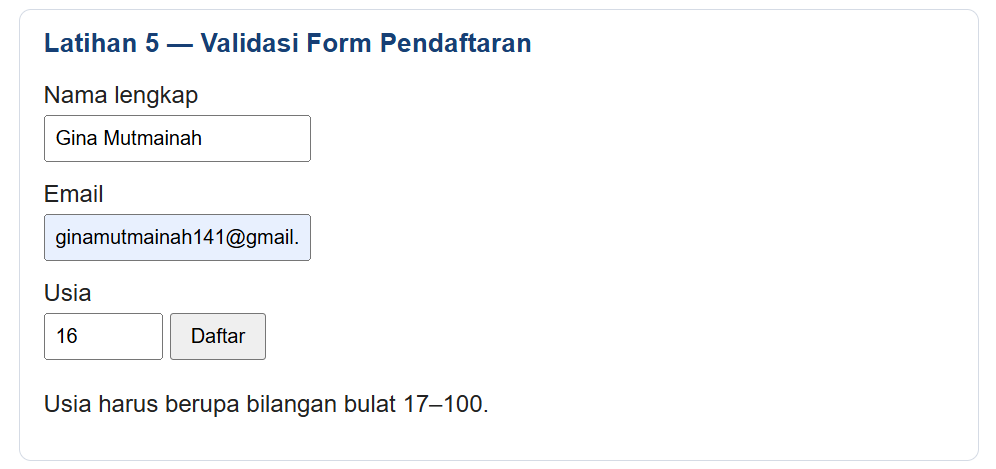 |
| 5 | Semua input valid | Validasi berhasil. Form siap diproses. | 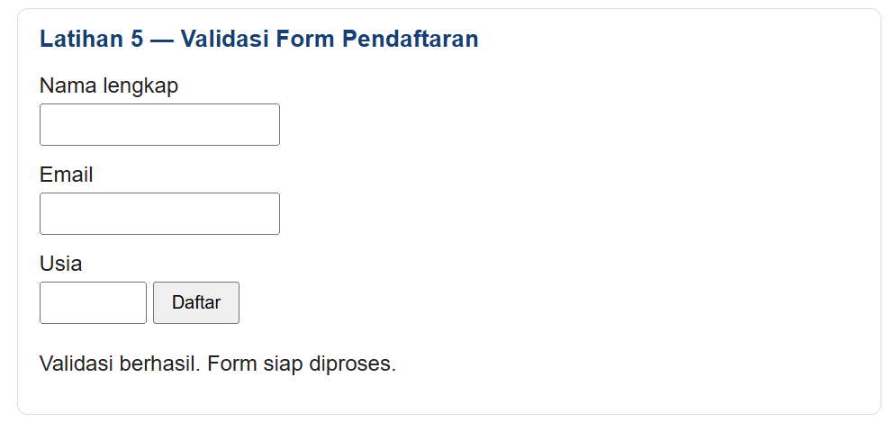 |

### Latihan 6 — Daftar Tugas (To-do List)
Elemen dibuat dengan `createElement()` dan teks pengguna ditampilkan memakai `textContent` (aman dari injeksi HTML). Tombol **Hapus** adalah Eksperimen Mandiri 1.

| Input kosong | Tambah dan tandai selesai | Hapus item |
|---|---|---|
| 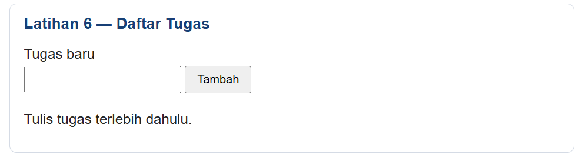 | 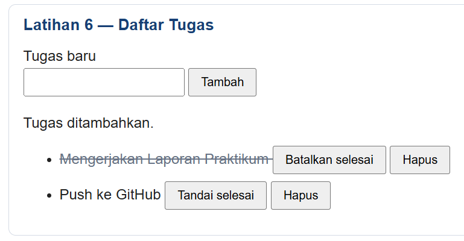 | 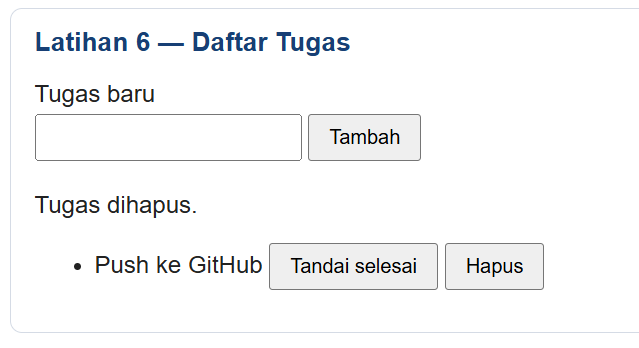 |

## Mini Project — Form Pendaftaran Workshop

Lima fungsi interaktif (minimal tiga) dengan file terpisah `index.html`, `style.css`, `script.js`:

| No | Fungsi interaktif | Event |
|---|---|---|
| 1 | Ringkasan input langsung (nama, email, sesi) | `input`, `change` |
| 2 | Penghitung karakter catatan (maks. 100) | `input` |
| 3 | Validasi nama (min. 3 karakter), email, sesi + pesan error/sukses | `submit` |
| 4 | Tombol Reset (hapus input dan pesan error) | `click` |
| 5 | Tombol sembunyikan/tampilkan info dengan class CSS | `click` |

Tampilan responsif memakai media query `max-width: 480px` sehingga tombol tersusun vertikal di layar kecil.

| Tampilan awal | Submit kosong (error) | Ringkasan langsung |
|---|---|---|
| 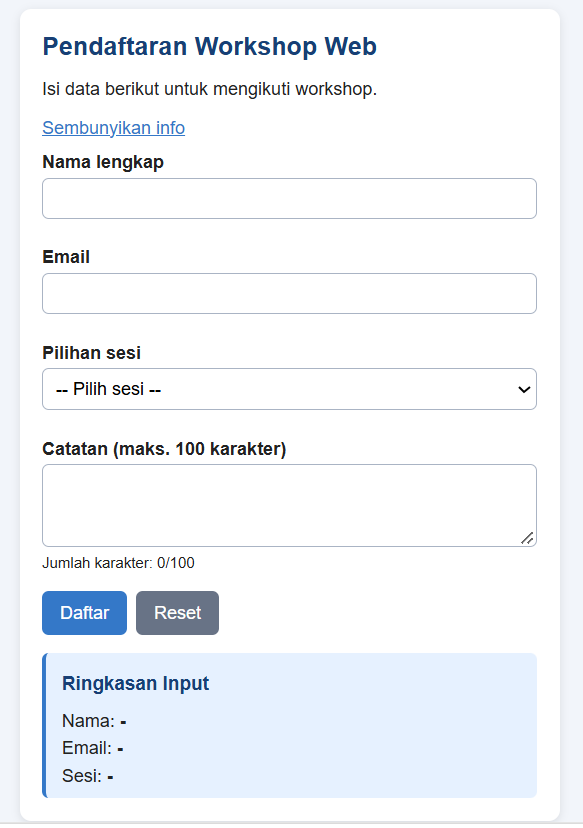 | 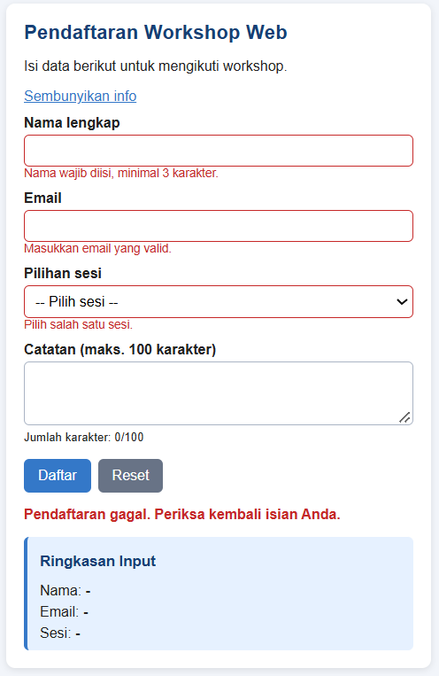 | 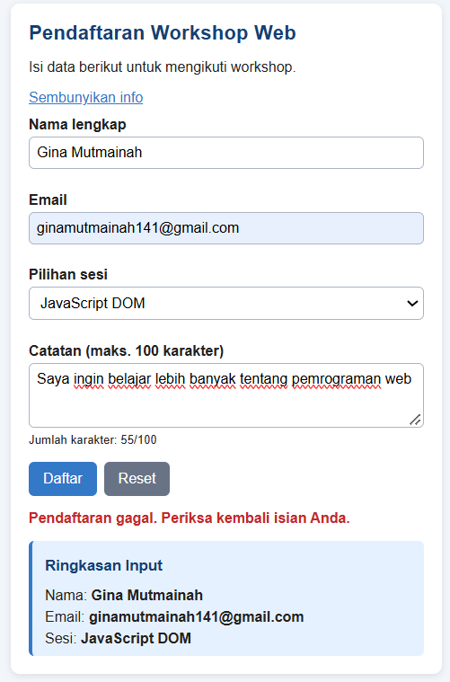 |

| Submit valid (sukses) | Setelah Reset | Info disembunyikan |
|---|---|---|
| 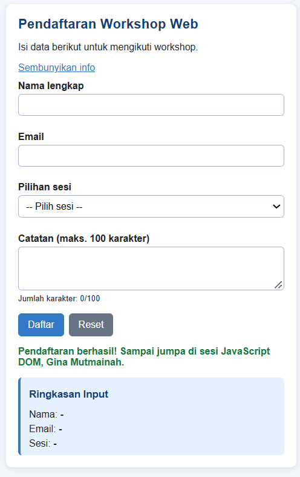 | 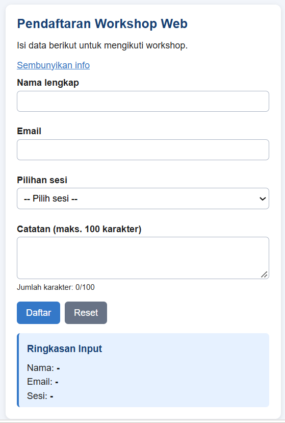 | 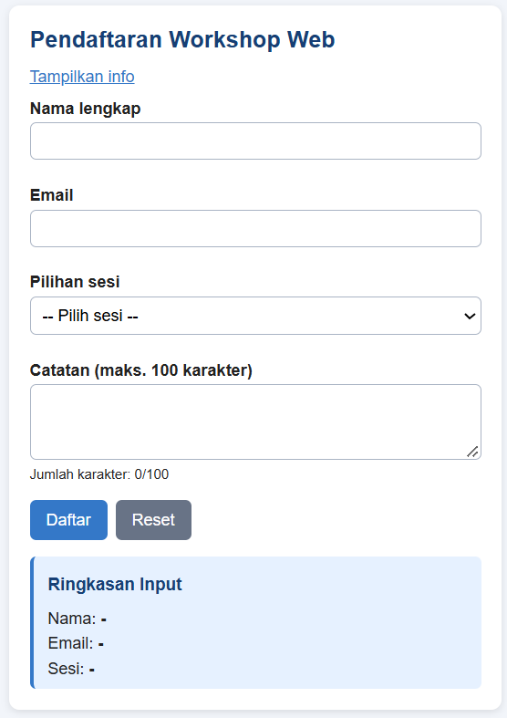 |

## Eksperimen Mandiri

1. **Hapus item To-do:** tombol "Hapus" dengan `item.remove()` (Latihan 6).
2. **Nama minimal tiga karakter:** kondisi `nama.length < 3` pada validasi mini project.
3. **Event `change` pada dropdown sesi:** `sesiEl.addEventListener("change", ...)` menampilkan sesi terpilih pada ringkasan.
4. **Sembunyikan/tampilkan paragraf:** `classList.toggle("sembunyi")` dengan aturan `.sembunyi { display: none; }`.
5. **Script tanpa `defer` di `<head>`:** muncul error `Cannot set properties of null (setting 'textContent')` karena script berjalan sebelum HTML diparsing, sehingga `getElementById()` mengembalikan `null`. Solusi: pakai `defer` atau letakkan `<script>` sebelum `</body>`.
